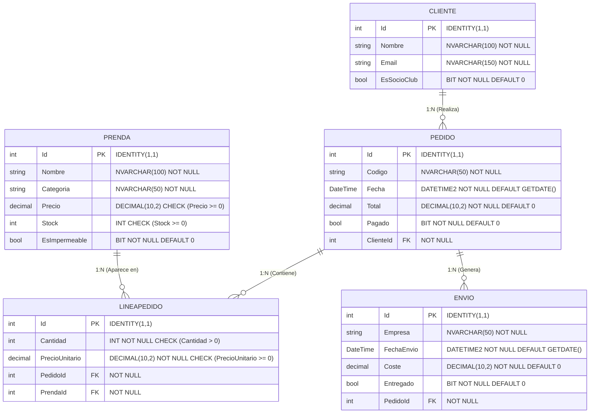

# Documentación del Proyecto: API REST "PeakTech"

**Actividad de Aprendizaje 1 — DWES (Desarrollo Web en Entorno Servidor)**  
**Centro:** San Valero / SEAS (Zaragoza)  
**Alumno:** Lorenzo (Usuario: `a19949`)  
**Repositorio GitHub:** [DWES_AA1](https://github.com/Lorenzoo195/DWES_AA1.git)  

---

## 1. Propósito y Dominio del Proyecto

**PeakTech** es una API RESTful desarrollada sobre **ASP.NET Core (.NET 10)** orientada a la gestión integral de un comercio electrónico especializado en ropa técnica y equipamiento de montaña de alto rendimiento.

La plataforma gestiona el ciclo completo de negocio:
- Catálogo de prendas técnicas (categorías, impermeabilidad, tallas, stock y precios).
- Gestión de clientes y fidelización al club de montaña (`EsSocioClub`).
- Registro y procesamiento de pedidos con cálculo de totales y estado de pago.
- Detalle de líneas de pedido (relación `N:M` entre pedidos y prendas con congelación de precio unitario).
- Trazabilidad y seguimiento logístico de envíos asociados a cada pedido.

---

## 2. Tecnologías y Arquitectura

- **Framework:** .NET 10.0 (ASP.NET Core Web API).
- **Acceso a Datos:** **ADO.NET Puro** mediante `Microsoft.Data.SqlClient`, utilizando `SqlConnection`, `SqlCommand` y `SqlDataReader`, garantizando un control granular del rendimiento, transacciones y consultas SQL parametrizadas para prevenir inyecciones SQL.
- **Patrón de Arquitectura:** **Patrón Repositorio** (Repository Pattern). Las interfaces (`IPrendaRepository`, `IClienteRepository`, `IPedidoRepository`, `ILineaPedidoRepository`, `IEnvioRepository`) desacoplan los controladores de la infraestructura de base de datos y se registran como servicios *Scoped* mediante Inyección de Dependencias en `Program.cs`.
- **Motor de Base de Datos:** **Microsoft SQL Server 2022** (edición Express) desplegado sobre contenedor Docker.
- **Contenedores y Orquestación:** 
  - `Dockerfile` con compilación multi-etapa (*multi-stage build*) sobre imágenes oficiales de .NET 10 SDK y Runtime Linux, reduciendo drásticamente el peso de la imagen final.
  - `docker-compose.yml` para orquestar la API y la base de datos dentro de una red privada (`red_tienda`) con volumen persistente (`db_data`).
- **Control de Versiones y Metodología:**
  - Metodología **GitFlow** con ramas troncales (`main`, `develop`) y ramas de trabajo (`feature/entities`, `feature/dtos`, `feature/database-setup`, `feature/repositories`, `feature/controller`).
  - **GitHub Actions:** Pipeline de Integración Continua (`.github/workflows/ci.yml`) que compila la solución en cada push o pull request hacia `main` o `develop`.

---

## 3. Estrategia de Entornos y Puertos (Twelve-Factor App)

Siguiendo las buenas prácticas industriales de la metodología **Twelve-Factor App** (Factores III, V y X: configuración desacoplada del código fuente, artefacto único inmutable y paridad estricta entre entornos), la aplicación cuenta con **3 perfiles de ejecución** totalmente configurados:

| Entorno | Archivo `.env` | Puerto HTTP API | Puerto HTTPS API | Puerto BD Host | Perfil ASP.NET Core | URL Swagger |
| :--- | :--- | :--- | :--- | :--- | :--- | :--- |
| **DEV** (Desarrollo) | `dev.env` | `1993` | `7993` | `3991` | `Development` | `https://localhost:7993/swagger` |
| **PRE** (Preproducción - **Oficial Alumno**) | `pre.env` (o `.env`) | **`1994`** | **`7994`** | **`4991`** | `Staging` | **`http://localhost:1994/swagger`** |
| **PRO** (Producción) | `pro.env` | `1995` | `7995` | `5991` | `Production` | `https://localhost:7995/swagger` |

### Asignación de Puertos según la Rúbrica Oficial:
- **Matrícula del Alumno:** `a19949`.
- **Puerto de la API en el Host:** Las cuatro últimas cifras $\rightarrow$ **`1994`**.
- **Puerto de la Base de Datos en el Host:** Las mismas cifras en orden inverso $\rightarrow$ **`4991`**.
- El entorno oficial por defecto para evaluación en Docker es **PRE (Preproducción)**, cumpliendo con exactitud la asignación de puertos solicitada.

---

## 4. Modelo Entidad-Relación

La base de datos relacional `TiendaRopaDb` implementa **5 entidades interconectadas** con restricciones de clave primaria, clave foránea y validaciones a nivel de motor (`CHECK` y `DEFAULT`):



### Reglas de Integridad y Restricciones:
1. **Precios y Stocks Positivos:** Restricciones `CHECK (Precio >= 0)` y `CHECK (Stock >= 0)` en `Prendas`.
2. **Líneas de Pedido Válidas:** `CHECK (Cantidad > 0)` y `CHECK (PrecioUnitario >= 0)` en `LineasPedido`.
3. **Persistencia del Historial de Precios:** La entidad `LineaPedido` almacena su propio `PrecioUnitario` en el instante de compra, asegurando que futuras modificaciones en el precio del catálogo de prendas no alteren la contabilidad de pedidos pasados.

---

## 5. DTOs y Validación de Entrada

Para desacoplar el modelo de dominio interno de las solicitudes externas y evitar ataques de asignación masiva (*Over-Posting*), la API implementa **Data Transfer Objects (DTOs)** en la capa de transporte:

- **`CreatePrendaDto`:** `Nombre`, `Categoria`, `Precio`, `Stock`, `EsImpermeable`.
- **`CreateClienteDto`:** `Nombre`, `Email`, `EsSocioClub`.
- **`CreatePedidoDto`:** `Codigo`, `Total`, `Pagado`, `ClienteId`.
- **`CreateLineaPedidoDto`:** `Cantidad`, `PrecioUnitario`, `PedidoId`, `PrendaId`.
- **`CreateEnvioDto`:** `Empresa`, `FechaEnvio`, `Coste`, `Entregado`, `PedidoId`.

### Validaciones con Data Annotations:
- `[Required]`: Campos obligatorios en todas las entidades.
- `[StringLength(100)]`: Control de longitud de cadenas de texto.
- `[Range(0.01, 10000.00)]`: Rango válido para precios y costes.
- `[Range(1, 1000)]`: Rango válido para cantidades y existencias.
- `[EmailAddress]`: Validación estricta del formato de correo electrónico.
- **Manejo en Controlador:** Todos los métodos de creación y actualización validan explícitamente `ModelState.IsValid`, respondiendo con código HTTP `400 Bad Request` y el desglose de errores de validación.

---

## 6. Endpoints y Operaciones de la API

La API ofrece operaciones completas de lectura, creación, actualización y borrado (CRUD), junto con filtros, ordenación y recursos anidados:

### 6.1. Prendas (`/api/prenda`)
- `GET /api/prenda`: Listado completo con filtros opcionales por query string:
  - `?categoria=Chaquetas`: Filtra por categoría.
  - `?esImpermeable=true`: Filtra prendas impermeables.
  - `?precioAscendente=true|false`: Ordena por precio ascendente o descendente.
- `GET /api/prenda/{id}`: Obtiene una prenda por su ID (`200 OK` o `404 Not Found`).
- `POST /api/prenda`: Crea una nueva prenda validando el DTO (`201 CreatedAtAction`).
- `PUT /api/prenda/{id}`: Actualiza una prenda existente (`204 NoContent`).
- `DELETE /api/prenda/{id}`: Elimina una prenda del catálogo (`204 NoContent`).
- `GET /api/prenda/estadisticas`: **Endpoint Agregado** (precio medio, prenda más cara, prenda más barata y total de stock).

### 6.2. Clientes (`/api/cliente`)
- `GET /api/cliente`: Listado con filtro opcional `?esSocio=true|false`.
- `GET /api/cliente/{id}`: Obtiene el cliente por su ID.
- `POST /api/cliente`: Alta de nuevo cliente validando DTO.
- `PUT /api/cliente/{id}`: Actualización de datos del cliente.
- `DELETE /api/cliente/{id}`: Baja de cliente.
- `GET /api/cliente/{id}/pedidos`: **Recurso Relacionado Anidado**. Consulta todos los pedidos realizados por el cliente indicado.

### 6.3. Pedidos (`/api/pedido`)
- `GET /api/pedido`: Listado de pedidos con filtros opcionales:
  - `?pagado=true|false`: Filtrar pedidos abonados o pendientes.
  - `?masRecientesPrimero=true|false`: Ordenación cronológica por fecha.
- `GET /api/pedido/{id}`: Detalle de cabecera de pedido.
- `POST /api/pedido`: Creación de pedido.
- `PUT /api/pedido/{id}`: Actualización de estado o totales.
- `DELETE /api/pedido/{id}`: Cancelación de pedido.
- `GET /api/pedido/{id}/lineas`: Consulta las líneas de compra asociadas al pedido.
- `GET /api/pedido/{id}/envios`: Consulta los envíos logísticos asignados al pedido.
- `GET /api/pedido/estadisticas`: **Endpoint Agregado** (facturación total acumulada, importe medio por pedido, recuento de pedidos pagados vs pendientes).

### 6.4. Líneas de Pedido (`/api/lineapedido`) y Envíos (`/api/envio`)
- Endpoints CRUD dedicados para gestión de líneas y expediciones logísticas.

---

## 7. Guía de Ejecución y Despliegue

La solución admite dos modalidades de trabajo perfectamente armonizadas:

### Modalidad 1: Orquestación Completa con Docker Compose (Recomendada para Evaluación)

Esta modalidad levanta la API y la base de datos en contenedores Linux idénticos a los de producción:

1. **Clonar el repositorio y situarse en la raíz:**
   ```powershell
   git clone https://github.com/Lorenzoo195/DWES_AA1.git
   cd DWES_AA1
   ```

2. **Levantar los servicios en el entorno oficial (PRE - Puertos 1994 / 4991):**
   ```powershell
   docker compose up -d
   ```
   *(Si se desea arrancar otro entorno específico mediante el parámetro `--env-file`):*
   - Entorno DEV: `docker compose --env-file dev.env up -d`
   - Entorno PRO: `docker compose --env-file pro.env up -d`

3. **Inicializar la Base de Datos (Solo la primera vez):**
   - Abrir el archivo `DB/createDB.sql` en Visual Studio Code.
   - Conectar con la extensión *SQL Server (mssql)* utilizando:
     - **Server:** `localhost`
     - **Port:** `4991` (Puerto oficial de PRE)
     - **User:** `sa`
     - **Password:** `YourPassword123!`
     - **Trust server certificate:** Activado
   - Ejecutar el script (**Execute Query** / `Ctrl + Shift + E`). Creará la base de datos `TiendaRopaDb`, las 5 tablas y los registros de prueba.

4. **Acceder a la Documentación Interactiva (Swagger UI):**
   Abrir en el navegador:
   ```
   http://localhost:1994/swagger
   ```
   *(La raíz `http://localhost:1994` redirige automáticamente a `/swagger`).*

5. **Recompilar tras modificar código:**
   ```powershell
   docker compose up -d --build
   ```

---

### Modalidad 2: Desarrollo y Depuración Local en Visual Studio Code / Terminal

Esta modalidad permite ejecutar la API directamente sobre Windows con soporte de depuración con puntos de interrupción (`F5`) o ejecución mediante la CLI de .NET, conectando contra la base de datos en Docker:

1. **Asegurar que la base de datos está encendida en Docker:**
   ```powershell
   docker compose up -d db
   ```
   *(No es necesario levantar el contenedor `api_tienda` para depurar en local).*

2. **Opción 2A — Depuración con Visual Studio Code (`F5`):**
   - Pulsar `Ctrl + Shift + D` (panel *Run and Debug*).
   - Seleccionar en el desplegable superior el perfil deseado:
     - **`DEV`**: Escucha en `https://localhost:7993` y `http://localhost:1993`
     - **`PRE`**: Escucha en `https://localhost:7994` y `http://localhost:1994`
     - **`PRO`**: Escucha en `https://localhost:7995` y `http://localhost:1995`
   - Pulsar `F5`. VS Code compilará, iniciará el proceso con depurador y abrirá automáticamente el navegador en la URL de Swagger.

3. **Opción 2B — Ejecución por consola con `dotnet run`:**
   ```powershell
   # Ejecutar en perfil Desarrollo
   dotnet run --launch-profile DEV

   # Ejecutar en perfil Preproducción
   dotnet run --launch-profile PRE

   # Ejecutar en perfil Producción
   dotnet run --launch-profile PRO
   ```

4. **Soporte HTTPS y Certificados:**
   - La API cuenta con redirección forzada a HTTPS vía middleware (`app.UseHttpsRedirection()`).
   - El certificado local se gestiona con la herramienta oficial de .NET:
     ```powershell
     dotnet dev-certs https --trust
     ```

5. **Ajuste Técnico en Producción (`appsettings.Production.json`):**
   Para permitir que VS Code y los monitores capturen la dirección de enlace en producción sin romper la directiva de logs silenciosos (`Warning`), se habilitó la categoría de ciclo de vida del servidor:
   ```json
   {
     "Logging": {
       "LogLevel": {
         "Default": "Warning",
         "Microsoft.AspNetCore": "Warning",
         "Microsoft.Hosting.Lifetime": "Information"
       }
     }
   }
   ```
