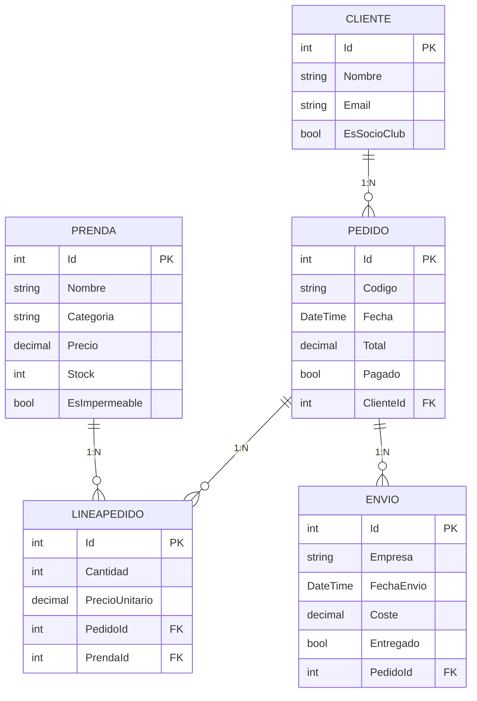

# Documentación del Proyecto: API REST "PeakTech"

**Actividad de Aprendizaje 1 — DWES (Desarrollo Web en Entorno Servidor)**  
**Centro:** San Valero / SEAS  
**Alumno:** Lorenzo (Usuario: a19949)  

---

## 1. Propósito del Proyecto
**PeakTech** es una API RESTful desarrollada sobre ASP.NET Core (.NET 10) orientada al comercio electrónico de ropa técnica y material de montaña. Permite gestionar de manera integral el catálogo de prendas, los clientes dados de alta en el club, la generación de pedidos con sus líneas de compra detalladas y el seguimiento logístico de los envíos asociados.

---

## 2. Tecnologías y Arquitectura

- **Framework:** .NET 10.0 (ASP.NET Core Web API).
- **Acceso a Datos:** **ADO.NET** mediante `Microsoft.Data.SqlClient`, utilizando `SqlConnection`, `SqlCommand` y `SqlDataReader`.
- **Patrón de Diseño:** **Patrón Repositorio** (interfaces e implementaciones desacopladas registradas mediante inyección de dependencias en `Program.cs`).
- **Base de Datos:** **Microsoft SQL Server 2022** (edición Express) ejecutado en contenedor Docker.
- **Contenedores y Orquestación:** 
  - `Dockerfile` con compilación multi-etapa (*multi-stage build*) para optimizar el tamaño de la imagen final.
  - `docker-compose.yml` para orquestar conjuntamente la API y la base de datos con volúmenes persistentes.
- **Control de Versiones y CI/CD:** 
  - Metodología **GitFlow** con ramas principales (`main`, `develop`) y ramas de funcionalidad (`feature/*`).
  - Integración continua automatizada con **GitHub Actions** (`.github/workflows/ci.yml`).

---

## 3. Configuración de Red y Puertos (Host / Anfitrión)

Cumpliendo con los criterios del trabajo basados en el identificador de alumno:
- **Puerto de la API REST (Host):** `1994` (redireccionado al puerto interno `8080` de .NET).
  - Acceso a documentación Swagger: `http://localhost:1994/swagger`
- **Puerto de la Base de Datos (Host):** `4991` (puerto invertido, redireccionado al puerto interno `1433` de SQL Server).
  - Conexión local / SSMS / Azure Data Studio: `localhost,4991`

---

## 4. Modelo Entidad-Relación

El modelo cuenta con **5 entidades relacionadas**, cubriendo tipos de datos variados (`int`, `string`, `decimal`, `bool`, `DateTime`) y restricciones de integridad:



### Descripción de Entidades y Relaciones:
1. **Cliente:** Almacena información de los usuarios y si pertenecen al club de socios (`EsSocioClub`).
2. **Prenda:** Catálogo de productos con categoría, precio (con restricción `CHECK (Precio >= 0)`), stock y si cuenta con membrana impermeable (`EsImpermeable`).
3. **Pedido:** Cabecera de compra asociada a un cliente (`ClienteId`), con código único, fecha, total acumulado y estado de pago.
4. **LineaPedido:** Detalle de cada compra (`N:M` entre Pedido y Prenda). Contiene la cantidad solicitada y el precio unitario congelado en el momento de la compra.
5. **Envio:** Registra las expediciones logísticas asociadas a un pedido, transportista, fecha, coste y estado de entrega.

---

## 5. DTOs y Validaciones de Entrada

Para garantizar la seguridad de la API y no exponer directamente las entidades de dominio en las peticiones de creación:
- **DTOs implementados:** `CreatePrendaDto`, `CreateClienteDto`, etc.
- **Validaciones automáticas:** Utilización de Data Annotations (`[Required]`, `[StringLength]`, `[Range]`, `[EmailAddress]`).
- **Control de errores:** Validación en controladores mediante `ModelState.IsValid`, devolviendo códigos `400 Bad Request` con mensajes descriptivos si los datos no cumplen las reglas de negocio.

---

## 6. Instrucciones de Ejecución

### Opción A: Ejecución completa con Docker Compose
1. Clonar el repositorio y situarse en la raíz del proyecto.
2. Levantar la base de datos y la API en segundo plano:
   ```bash
   docker compose up -d
   ```
3. Acceder al explorador y probar los endpoints en Swagger:
   ```
   http://localhost:1994/swagger
   ```

### Opción B: Ejecución de la API en local contra SQL Server en Docker
1. Iniciar únicamente el contenedor de base de datos:
   ```bash
   docker compose up -d sqlserver
   ```
2. Ejecutar el script `DB/createDB.sql` conectándose a `localhost,4991`.
3. Iniciar la API con el CLI de .NET:
   ```bash
   dotnet run
   ```
