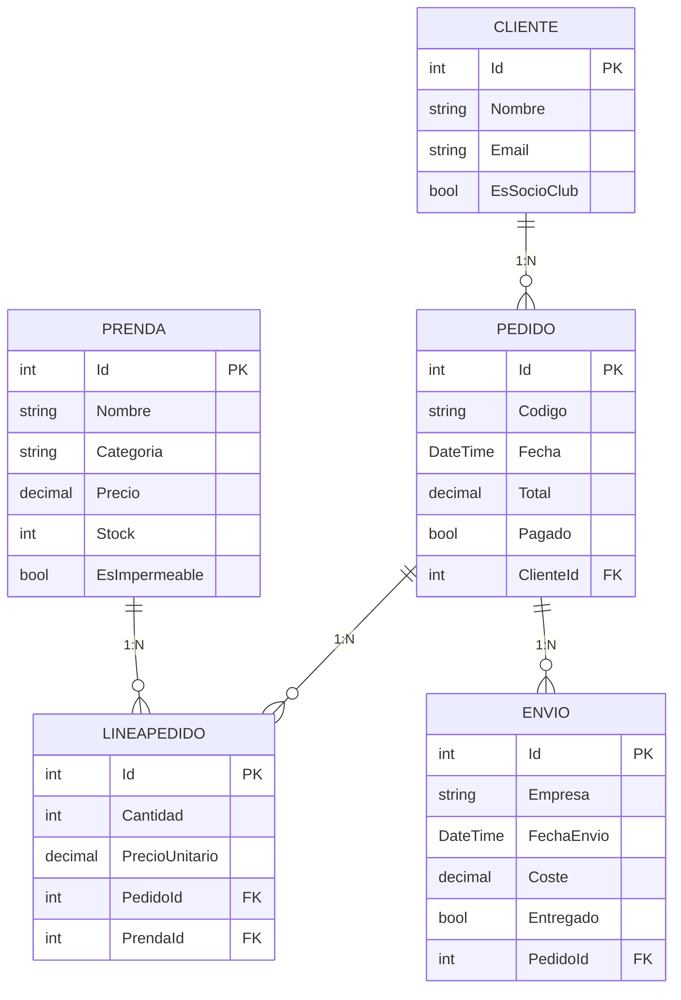

# Documentación del Proyecto: API REST "PeakTech"

**Actividad de Aprendizaje 1 — DWES**  
Centro: San Valero / SEAS  

---

## 1. Propósito del Proyecto
API RESTful desarrollada en ASP.NET Core (.NET 10) para la gestión del catálogo, pedidos, clientes y seguimiento logístico de una tienda especializada en ropa técnica y equipamiento de montaña.

---

## 2. Tecnologías y Dependencias
- **Framework:** .NET 10.0 (ASP.NET Core Web API)
- **Anotaciones de Datos:** `System.ComponentModel.DataAnnotations.Schema` (`[ForeignKey]`)
- **Documentación:** OpenAPI / Swagger UI
- **Control de Versiones:** GitFlow (`main`, `develop`, `feature/*`) con integración continua en GitHub Actions.

---

## 3. Modelo Entidad-Relación

---

## 4. Descripción de Relaciones

- **Cliente $\rightarrow$ Pedido (`1:N`):** Un cliente puede tener múltiples pedidos. Clave foránea `ClienteId` en `Pedido`.
- **Pedido $\leftrightarrow$ Prenda (`N:M` mediante `LineaPedido`):** Relación muchos a muchos descompuesta. `LineaPedido` almacena `PedidoId` y `PrendaId` junto con la cantidad y el precio unitario congelado de la compra.
- **Pedido $\rightarrow$ Envio (`1:N`):** Un pedido puede tener uno o varios envíos asociados (envíos parciales o reintentos de entrega). Clave foránea `PedidoId` en `Envio`.
