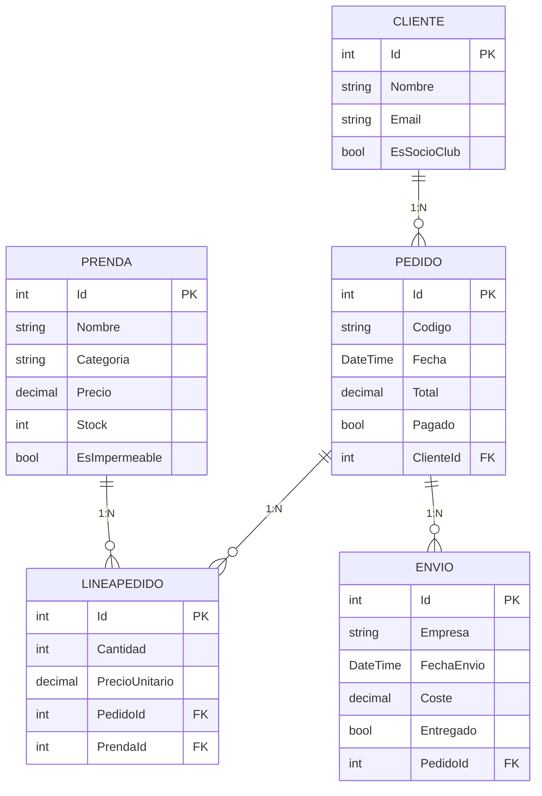

# Documentación del Proyecto: API REST "PeakTech"

**Actividad de Aprendizaje 1 — DWES (Desarrollo Web en Entorno Servidor)**  
**Centro:** San Valero / SEAS  
**Alumno:** Lorenzo (Usuario: a19949)  

---

## 1. Propósito del Proyecto
**PeakTech** es una API RESTful desarrollada sobre ASP.NET Core (.NET 10) orientada al comercio electrónico de ropa técnica y material de montaña. Permite gestionar de manera integral el catálogo de prendas, los clientes dados de alta en el club, la generación de pedidos con sus líneas de compra detalladas y el seguimiento logístico de los envíos asociados.

---

## 2. Tecnologías y Arquitectura

- **Framework:** .NET 10.0 (ASP.NET Core Web API).
- **Acceso a Datos:** **ADO.NET** mediante `Microsoft.Data.SqlClient`, utilizando `SqlConnection`, `SqlCommand` y `SqlDataReader`.
- **Patrón de Diseño:** **Patrón Repositorio** (interfaces e implementaciones desacopladas registradas mediante inyección de dependencias en `Program.cs`).
- **Base de Datos:** **Microsoft SQL Server 2022** (edición Express) ejecutado en contenedor Docker.
- **Contenedores y Orquestación:** 
  - `Dockerfile` con compilación multi-etapa (*multi-stage build*) para optimizar el tamaño de la imagen final.
  - `docker-compose.yml` para orquestar conjuntamente la API y la base de datos con volúmenes persistentes.
- **Control de Versiones y CI/CD:** 
  - Metodología **GitFlow** con ramas principales (`main`, `develop`) y ramas de funcionalidad (`feature/*`).
  - Integración continua automatizada con **GitHub Actions** (`.github/workflows/ci.yml`).

---

## 3. Configuración de Entornos y Puertos (Twelve-Factor App)

Siguiendo las buenas prácticas de la industria y la metodología **Twelve-Factor App** (Factores III, V y X: separación estricta de configuración y código, artefacto único inmutable y paridad entre entornos), la aplicación cuenta con **3 perfiles de ejecución** configurados mediante variables de entorno y archivos `.env`:

| Entorno | Archivo de Configuración | Puerto API (Host) | Puerto BD (Host) | Entorno .NET | Acceso Swagger |
| :--- | :--- | :--- | :--- | :--- | :--- |
| **DEV** (Desarrollo) | `dev.env` | `1993` | `3991` | `Development` | `http://localhost:1993/swagger` |
| **PRE** (Preproducción - Activo/Oficial) | `pre.env` (o `.env`) | **`1994`** | **`4991`** | `Staging` | **`http://localhost:1994/swagger`** |
| **PRO** (Producción) | `pro.env` | `1995` | `5991` | `Production` | `http://localhost:1995/swagger` |

- **Identificador de alumno (`a19949`):** Asignado oficialmente al entorno activo **PRE** (`1994` API / `4991` BD).

---

## 4. Modelo Entidad-Relación

El modelo cuenta con **5 entidades relacionadas**, cubriendo tipos de datos variados (`int`, `string`, `decimal`, `bool`, `DateTime`) y restricciones de integridad:



### Descripción de Entidades y Relaciones:
1. **Cliente:** Almacena información de los usuarios y si pertenecen al club de socios (`EsSocioClub`).
2. **Prenda:** Catálogo de productos con categoría, precio (con restricción `CHECK (Precio >= 0)`), stock y si cuenta con membrana impermeable (`EsImpermeable`).
3. **Pedido:** Cabecera de compra asociada a un cliente (`ClienteId`), con código único, fecha, total acumulado y estado de pago.
4. **LineaPedido:** Detalle de cada compra (`N:M` entre Pedido y Prenda). Contiene la cantidad solicitada y el precio unitario congelado en el momento de la compra.
5. **Envio:** Registra las expediciones logísticas asociadas a un pedido, transportista, fecha, coste y estado de entrega.

---

## 5. DTOs y Validaciones de Entrada

Para garantizar la seguridad de la API y no exponer directamente las entidades de dominio en las peticiones de creación:
- **DTOs implementados:** `CreatePrendaDto`, `CreateClienteDto`, etc.
- **Validaciones automáticas:** Utilización de Data Annotations (`[Required]`, `[StringLength]`, `[Range]`, `[EmailAddress]`).
- **Control de errores:** Validación en controladores mediante `ModelState.IsValid`, devolviendo códigos `400 Bad Request` con mensajes descriptivos si los datos no cumplen las reglas de negocio.

---

## 6. Instrucciones de Ejecución

### Opción A: Ejecución con Docker Compose (Recomendada)
1. **Clonar el repositorio y situarse en la raíz del proyecto:**
   ```bash
   git clone https://github.com/Lorenzoo195/DWES_AA1.git
   cd DWES_AA1
   ```

2. **Levantar los contenedores:**
   Por defecto, la aplicación arranca en el entorno **PRE (Preproducción)** usando el archivo `.env`:
   ```bash
   docker compose up -d
   ```
   *(Si se desea arrancar un perfil específico, se utiliza el parámetro `--env-file`):*
   - Para Desarrollo: `docker compose --env-file dev.env up -d`
   - Para Preproducción: `docker compose --env-file pre.env up -d`
   - Para Producción: `docker compose --env-file pro.env up -d`

3. **Inicializar la Base de Datos (Solo la primera vez):**
   Para crear la base de datos `TiendaRopaDb`, las tablas y los datos de prueba:
   Abrir el archivo `DB/createDB.sql` en Visual Studio Code, conectar con la extensión *SQL Server (mssql)* a `localhost` en el puerto del entorno activo (para PRE: puerto oficial `4991`, Usuario: `sa`, Contraseña: `PrePassword123!`) y ejecutar el script (**Execute Query**).

4. **Acceder a la Documentación Interactiva (Swagger UI):**
   Abrir en el navegador (para el entorno activo PRE):
   ```
   http://localhost:1994/swagger
   ```
   *(En DEV se accede por `http://localhost:1993/swagger` y en PRO por `http://localhost:1995/swagger`)*.

5. **Recompilar tras realizar cambios en el código:**
   Si se añaden o modifican controladores, modelos o repositorios, para volver a compilar la imagen y actualizar el contenedor:
   ```bash
   docker compose up -d --build
   ```

---

### Opción B: Ejecución de la API en local contra SQL Server en Docker
1. **Iniciar únicamente el contenedor de base de datos:**
   ```bash
   docker compose up -d sqlserver
   ```
2. **Ejecutar el script `DB/createDB.sql`** conectándose a `localhost,4991`.
3. **Iniciar la API localmente:**
   ```bash
   dotnet run
   ```

4. **Acceder a la Documentación Interactiva (Swagger UI en local):**
   Abrir en el navegador:
   ```
   http://localhost:5047/swagger
   ```

